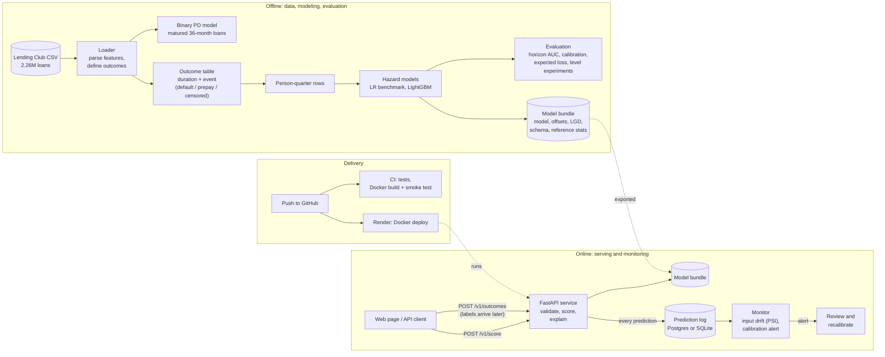
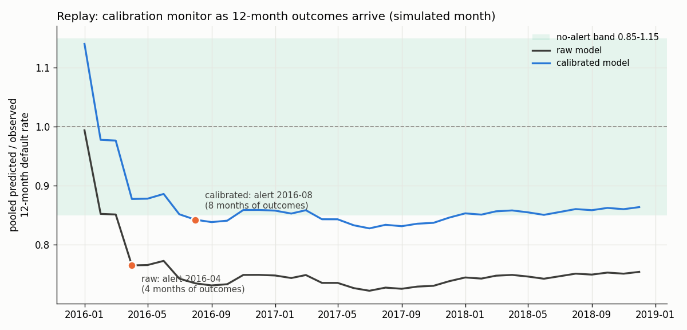

# Predicting when Lending Club loans default

[](https://github.com/jessi-sidhu/credit-risk-modeling/actions/workflows/ci.yml)
[](https://credit-risk-api-fxk5.onrender.com)


A credit risk model built on 2.26 million Lending Club loans. It estimates each loan's chance of default over time and its expected loss, it is validated on later years than it was trained on, and it runs as a monitored web service.

**Try it:** [credit-risk-api-fxk5.onrender.com](https://credit-risk-api-fxk5.onrender.com) scores a loan application and draws its default curve ([see an example](https://credit-risk-api-fxk5.onrender.com/#example) · [API docs](https://credit-risk-api-fxk5.onrender.com/docs)). It runs on free hosting, so the first visit after a quiet spell takes about a minute to wake up.

## The problem

A lender needs two numbers for every loan: how likely it is to default, and how much money that would cost. Lending Club's public data looks ideal for this, with 2.26 million loans issued between 2007 and 2018, but three things make it harder than a standard classification task.

1. **Most loans haven't finished.** At the snapshot date (March 2019) many loans are still being repaid. Treating them as "did not default" overstates quality, and dropping them throws away most of the recent data. Even among finished loans, recent cohorts are biased: the only 2017 loans that had finished by 2019 are the ones that paid off early or failed fast.
2. **Loans can end in two ways.** A borrower can default, or repay early. A loan that has been repaid can no longer default, so early repayment competes with default rather than being a neutral outcome.
3. **The past is not the future.** A model is used on loans issued after it was trained. Lending Club's later loans were riskier than its earlier ones at the same grade, and a model checked on a random split never sees that.

## What I found

- **How default is defined changes the answer.** Counting all finished loans, 19.98% defaulted. Restricting to cohorts old enough to have finished (36-month loans issued by March 2016) gives 14.22%. The gap is the bias from point 1, so every model here either uses the cleaner definition or models unfinished loans explicitly.
- **A gradient-boosted model barely beats logistic regression.** On loans issued in 2015–2016, LightGBM's ROC-AUC is 0.6817 against 0.6803 for logistic regression. The gain is statistically real (+0.0014, 95% CI +0.0006 to +0.0021) but too small to matter. Most of the signal in application data is linear, and much of it is already captured by Lending Club's own grade and interest rate.
- **Every model under-predicts default on newer loans, and that is the main problem.** The survival model predicts only 71–80% of the defaults that actually happened in each 2015–2018 cohort. Defaults rose from 12.63% of loans in the training years to 15.18% in the test years, and nothing in an application reveals that shift.
- **Re-estimating the level on recent loans helps; macro data does not.** Adjusting the model's default level on the 2014 cohort closes about 30% of the gap (predicted ÷ realized loss on matured test loans goes from 0.726 to 0.814). Adding the US unemployment rate, even with perfect foresight, makes the linear model worse, because unemployment fell while defaults rose.
- **Monitoring would have caught it early.** Replaying 2015–2018 through the live service month by month, the calibration alert fires after just four months of outcome data (April 2016), with the model predicting 0.765 of observed defaults.

## How it works

**Defining the outcome.** Each loan gets a duration (months from issue to its outcome) and an event: default, early repayment, or still running (censored). A loan still running at the snapshot contributes the months it was observed and then drops out, instead of being thrown away or counted as good. Loans that were seriously late at the snapshot but not yet charged off are checked separately, because Lending Club records a charge-off months after the first missed payment.

**Two models.** A binary default model on matured 36-month loans is the baseline. The main model is a discrete-time competing-risks hazard model: each loan becomes one row per quarter it was at risk, and a classifier predicts, for that quarter, the chance of default and of repayment given the loan is still active. Chaining those quarterly hazards gives the loan's whole default curve, and combining the curve with the remaining balance gives expected loss:

```
S(t)           = Π (1 − h_default − h_prepay)      chance the loan is still active after quarter t
CIF_default(t) = Σ S(t−1) · h_default(t)           chance it has defaulted by quarter t
ECL            = Σ PD(t) × balance(t) × LGD × discount(t)
```

Each model is fit twice: logistic regression as the transparent benchmark, LightGBM as the flexible challenger.

**Validating honestly.** Models are trained on loans issued up to 2013, tuned on 2014 and tested on 2015 onwards, never on a random split. Tests check that post-origination columns (payments received, recoveries, last payment date) can never enter the feature set, and that the served model gives the same scores as the training code to six decimal places.

## Architecture



A request flows through the service like this: the application is validated against the training schema, the ratio features are computed, the model produces quarterly hazards, those become the default curve, and the curve is combined with the loan's amortization schedule and a grade-level loss rate to give expected loss. The four inputs that push the score up most come back as plain-English reasons, and any input outside the training range is flagged.

## Results in numbers

**Binary default model**, tested on 372,802 36-month loans issued January 2015 to March 2016 (default rate 15.18%):

| | ROC-AUC [95% CI] | PR-AUC [95% CI] | Brier |
|---|---|---|---:|
| Logistic regression | 0.6803 [0.6780, 0.6824] | 0.2593 [0.2565, 0.2621] | 0.1233 |
| LightGBM | 0.6817 [0.6794, 0.6838] | 0.2612 [0.2585, 0.2643] | 0.1236 |

**Survival model**, tested on all 1,792,612 loans issued 2015–2018 (AUC of "defaulted by month h", on loans whose status at that point is known):

| Horizon | Logistic regression | LightGBM |
|---|---|---|
| 12 months | 0.6967 [0.6950, 0.6985] | 0.6996 [0.6977, 0.7013] |
| 36 months | 0.6891 [0.6878, 0.6904] | 0.6888 [0.6875, 0.6901] |

**Fixing the level** (LightGBM; predicted ÷ realized lifetime loss on matured test loans, 1.00 = exact):

| Base | Recalibrated on 2014 | Issue-date trend | Unemployment (perfect foresight) |
|---:|---:|---:|---:|
| 0.726 | 0.814 | 0.722 | 0.755 |

**Monitoring replay** (50,000 loans issued 2015–2018, each loan's outcome posted 12 months after issue):

| | Raw model | Calibrated model |
|---|---|---|
| Calibration alert first fires | April 2016, after 4 months of outcomes | August 2016, after 8 months |
| Final predicted ÷ observed | 0.754 | 0.864 |
| Latency per request (median / 95th pct) | 20.6 ms / 23.3 ms | 20.2 ms / 22.5 ms |



The full methodology, every table and the figures behind these numbers are in [`reports/report.md`](reports/report.md). Every number here is read from the result files in `reports/artifacts/` and `reports/monitoring/`, which the commands below regenerate.

## Running it

```bash
make install            # virtual environment and pinned dependencies
make test               # 172 tests; no Lending Club data needed
make serve              # scoring API on http://localhost:8000 (form at /, docs at /docs)
docker compose up       # API + Postgres (copy .env.example to .env first)
```

Score a loan from the command line:

```bash
curl -X POST https://credit-risk-api-fxk5.onrender.com/v1/score \
     -H 'Content-Type: application/json' --data @examples/sample_request.json
```

Reproducing the models needs the Kaggle Lending Club download (`accepted_2007_to_2018Q4.csv.gz`) in `data/archive/`:

```bash
make train              # binary default model and its evaluation
make train-survival     # outcome table, hazard models, evaluation, expected loss, level experiments
make export-model       # rebuild the served model bundle
make replay             # month-by-month monitoring replay through the API
make notebooks          # exploratory notebooks (EDA, SHAP, calibration, drift)
```

## Repository layout

| Path | What it holds |
|---|---|
| `src/data.py`, `src/features.py` | Lending Club loader, default definition, feature engineering |
| `src/train.py`, `src/evaluate.py` | Binary default model, out-of-time evaluation, bootstrap CIs, cost-based threshold |
| `src/survival_data.py`, `src/survival.py` | Outcome table, person-quarter expansion, hazard models, default curves |
| `src/train_survival.py`, `src/survival_eval.py`, `src/ecl.py`, `src/survival_level.py` | Training, evaluation, expected loss, level experiments |
| `src/serve/` | FastAPI service, scoring, prediction log, monitoring, replay |
| `models/pd_survival_v1/` | The served model bundle (model, level offsets, LGD table, schema, reference statistics, model card) |
| `notebooks/` | EDA, modeling, SHAP, calibration and drift notebooks |
| `reports/` | Full write-up, figures and result files |

## Limitations

- Default timing is approximated by the last payment date, because the data has no date of first missed payment.
- Only accepted loans are modeled; nothing is known about applicants Lending Club rejected.
- Lending Club's grade and interest rate are model inputs, so part of the measured performance belongs to Lending Club's own model.
- The under-prediction on newer loans is only partly fixed, and the fix (a level adjustment) is static.
- Loss given default is a simple average by grade.
- Monitoring was tested on replayed history, not live traffic.
- The reason codes explain the model's score; they are not regulatory adverse-action notices.

This is a portfolio project, not a credit decision tool.

## References

- Botha, A. & Verster, T. (2025). *Approaches for modelling the term-structure of default risk under IFRS 9: a tutorial using discrete-time survival analysis.* arXiv:2507.15441.
- Peng & Lessmann (2026). Drift-aware survival models. arXiv:2601.20533.
- Blumenstock, Lessmann & Seow (2022). Deep competing-risks models for credit risk.

## License

Code can be referenced. The model bundle in `models/pd_survival_v1/` is committed so the service can run anywhere; it holds the fitted model and summary statistics only, no loan records.
