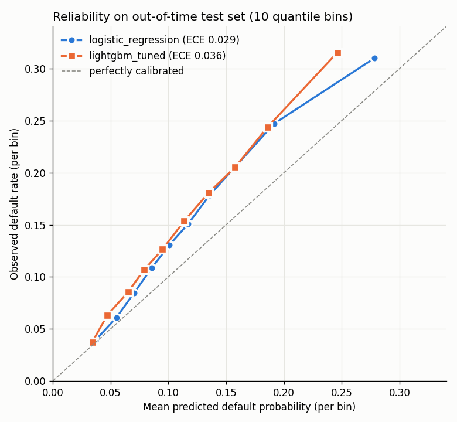
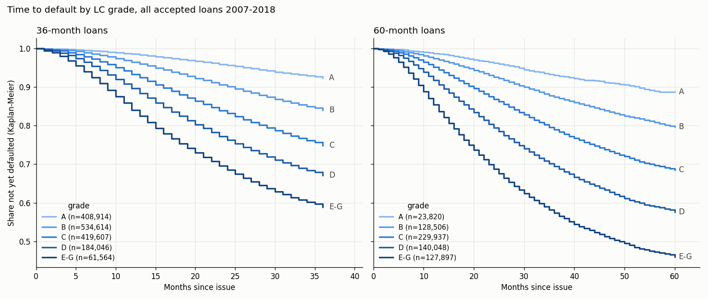
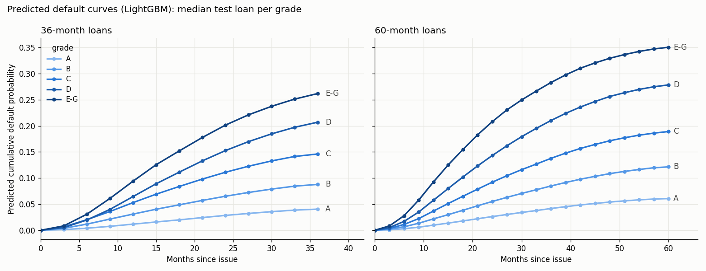
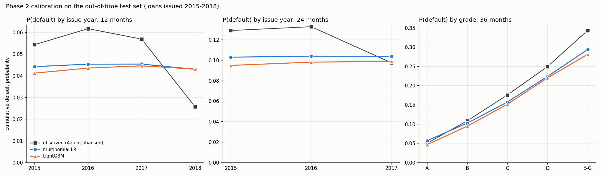
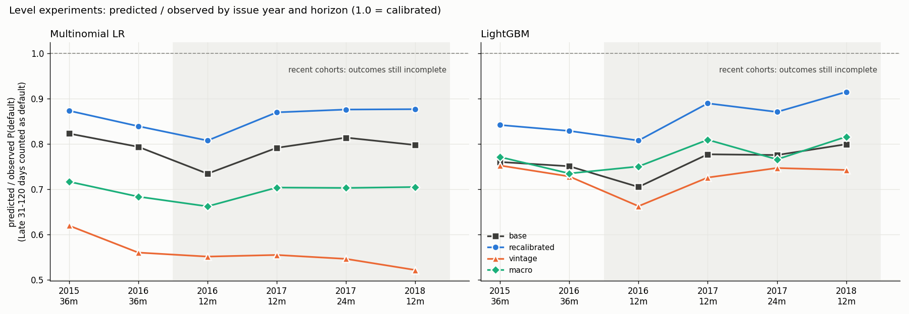
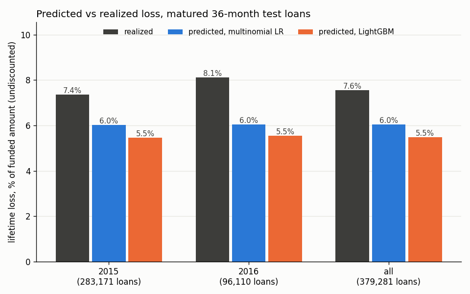

# Credit Risk Modeling on Lending Club Loans

Credit risk models for Lending Club loans, validated out of time, with logistic regression as the benchmark and LightGBM as the main model.

- **Phase 1:** probability of default for matured 36-month loans (2007–2016 originations). Numbers below come from `reports/artifacts/metrics.json`, written by `make train`.
- **Phase 2:** [time-to-default](#phase-2-time-to-default) competing-risks hazard model on all 2.26M loans, with lifetime expected loss. Numbers come from `reports/artifacts/survival/`, written by `make train-survival`.


## Results

Out-of-time test set: 372,802 loans issued 2015-01 to 2016-03, default rate 15.18%. Models were trained on loans issued up to 2013-12 and tuned on 2014. 95% CIs from 1,000 bootstrap resamples of the test set.

| Model | ROC-AUC [95% CI] | Gini | KS | PR-AUC [95% CI] | Brier | ECE |
|---|---|---:|---:|---|---:|---:|
| Logistic regression | 0.6803 [0.6780, 0.6824] | 0.3606 | 0.2641 | 0.2593 [0.2565, 0.2621] | 0.1233 | 0.0287 |
| LightGBM | 0.6817 [0.6794, 0.6838] | 0.3633 | 0.2661 | 0.2612 [0.2585, 0.2643] | 0.1236 | 0.0359 |

**LightGBM − LR (paired bootstrap):** ROC-AUC +0.0014 [+0.0006, +0.0021], PR-AUC +0.0019 [+0.0011, +0.0028].

The difference is statistically clear (both CIs exclude zero) but practically small. On these application-time features, the boosted model adds very little over a linear scorecard, and its probabilities are slightly less well calibrated (higher ECE). Both models under-predict default on the test cohort (see the reliability plot): the 2015–16 cohorts default more often (15.2%) than the training cohorts (12.6%).



**Cost-aware threshold.** A missed default is assumed to cost 5× a wrongly rejected good loan (`CostMatrix(fn_cost=5, fp_cost=1)`; expected cost = 5·FN + 1·FP). The threshold is picked on the 2014 validation set and then applied to the test set.

| Model | Threshold (from validation) | Precision | Recall | Expected cost | Expected cost at 0.5 |
|---|---:|---:|---:|---:|---:|
| Logistic regression | 0.16 | 0.267 | 0.430 | 228,017 | 282,274 |
| LightGBM | 0.15 | 0.259 | 0.481 | 224,701 | 282,940 |

At 0.5 almost no loans are flagged (LR flags 480, LightGBM none), so the 0.5 column is a "no model" baseline, not a competing operating point.

## How default is defined

From `loan_status` in the Kaggle `accepted_2007_to_2018Q4.csv` file, keeping finished loans only:

- `Fully Paid` and `Does not meet the credit policy. Status:Fully Paid` → 0
- `Charged Off`, `Default` and `Does not meet the credit policy. Status:Charged Off` → 1
- `Current`, `Late (16-30 days)`, `Late (31-120 days)` and `In Grace Period` are dropped (no final outcome yet).

Two further filters:

- **Matured cohorts only:** a loan is kept only if `issue_d + term ≤ 2019-03-31` (the snapshot date of the file). Without this, recent cohorts contain only the loans that already ended, mostly early payoffs and fast charge-offs, which biases the default rate.
- **36-month loans only:** after the maturity filter, no 60-month loan issued after 2014-03 survives, so an out-of-time test set would contain 36-month loans only. Training on both terms would mean the splits describe different products.

| Step | Rows |
|---|---:|
| Rows read | 2,260,668 |
| Finished loans | 1,348,099 |
| Key fields present | 1,347,721 |
| Matured by 2019-03-31 | 779,013 |
| 36-month loans | 710,794 |

| Split | Issue dates | Rows | Default rate |
|---|---|---:|---:|
| Train | 2007-06 – 2013-12 | 175,422 | 12.63% |
| Validation | 2014-01 – 2014-12 | 162,570 | 13.73% |
| Test | 2015-01 – 2016-03 | 372,802 | 15.18% |

## Features

All features are known when the application is decided. A test (`tests/test_features.py`) fails if any post-origination column (`total_pymnt`, `recoveries`, `last_pymnt_d`, `last_fico_range_*`, `out_prncp`, …) is a model feature or is even read from the CSV.

- **Borrower:** `fico` (mean of `fico_range_low/high` at application), `dti`, `annual_income`, `emp_length`, `home_ownership`, `open_acc`, `revol_util`
- **Loan:** `loan_amount`, `term`, `purpose`
- **LC pricing:** `grade`, `int_rate`
- **Engineered:** `loan_to_income`, `installment_estimate`, `installment_to_income`, `emp_x_homeowner` (emp_length × owns/mortgages home)

`grade` and `int_rate` are outputs of Lending Club's own risk model. They're legitimate at decision time, but using them means the model partly re-learns LC's score. `USE_LC_GRADE = False` in `src/features.py` drops them and the two installment features derived from `int_rate`.

## Quickstart

```bash
make install       # .venv + pinned deps
make test          # 129 tests (synthetic fixtures; the 1.6 GB CSV is not needed)
make smoke         # 5,000-row run on real data, no artifacts saved
make train         # full out-of-time run; writes reports/artifacts/metrics.json and the reliability plot
make train-random  # random 80/20 split, comparison only
make train-survival  # Phase 2: outcomes, hazard models, evaluation, expected loss
```

`make train` needs the Kaggle Lending Club download in `data/archive/` (git-ignored). The loader picks the `accepted_*` CSV (uncompressed if present, otherwise `.csv.gz`) and never reads the rejected-loans file.

## Method

- **Split:** out of time on `issue_d` (`src/train.py`, `TRAIN_UNTIL = "2013-12"`, `TEST_FROM = "2015-01"`). The test set is only used for the final report.
- **Preprocessing:** median imputation, scaling (LR only) and one-hot encoding inside an sklearn `Pipeline`, fit on the training split only.
- **Logistic regression:** no class reweighting, so its probabilities can be compared on Brier/ECE. Class imbalance is handled by the cost-optimal threshold instead.
- **LightGBM:** 30-candidate random search, each candidate fit on train with early stopping on validation PR-AUC; the best candidate by validation PR-AUC is kept (85 trees, 22 leaves, learning rate 0.037).
- **Metrics:** ROC-AUC, Gini (= 2·AUC − 1), KS, PR-AUC, Brier, ECE (10 quantile bins), and paired bootstrap CIs (`src/evaluate.py`).

## Known limitations

- **Binary target ignores timing.** A loan that charges off in month 3 and one that charges off in month 35 are the same label. Survival / time-to-default modeling is the next phase.
- **Accepted loans only.** There's no reject inference, so the model describes applicants LC approved, not the full applicant population.
- **LC grade is a feature.** `grade` and `int_rate` come from LC's own model, so part of the measured performance is LC's. See `USE_LC_GRADE` above.
- **36-month loans only.** 60-month loans are excluded (see above); the results don't describe them.
- **Default rate shifts over time.** The test cohorts default more often than the training cohorts, and both models under-predict on the test set. Recalibrating on recent cohorts would be needed before using the probabilities directly.
- **The cost matrix is a heuristic.** 5:1 is a rough rule of thumb, not a lender's measured loss.

## Phase 2: Time-to-default

Phase 1 asks *will this loan default?* and has to throw away every loan without a final outcome: of 2.26M accepted loans it keeps 710,794. Phase 2 asks *in which quarter will it default, and what is the expected loss over its life?* That lets every loan stay in:

- **Censoring.** A loan that is still running (Current, Late, In Grace) tells us it hasn't defaulted *yet*. It contributes the quarters it was observed for and is then censored, instead of being dropped.
- **Both terms.** 60-month loans come back (650,208 of them).
- **Prepayment is a competing risk.** A loan that is paid off early can no longer default, so treating payoff as "survived" would overstate how long loans stay at risk. Each quarter has three outcomes: no event, default, prepay.

Method: a discrete-time competing-risks hazard model (Botha & Verster 2025). Each loan becomes one row per quarter at risk, and a classifier predicts {no event, default, prepay} for that quarter. From the per-quarter hazards h:

- survival `S(t) = Π_{k≤t} (1 − h_default(k) − h_prepay(k))`
- cumulative default probability `CIF_default(t) = Σ_{k≤t} S(k−1) · h_default(k)`

Phase 1's binary model is unchanged and is the comparison point. All numbers in this section come from `reports/artifacts/survival/` (`outcomes_summary.json`, `train_meta.json`, `metrics.json`, `ecl.json`), written by `make train-survival`.

### Events

| `loan_status` | Event | Duration (months since issue) |
|---|---|---|
| Charged Off, Default (+ credit-policy variant) | default | to `last_pymnt_d` + 1 (first missed payment); 1 if no payment was ever made |
| Fully Paid (+ variant), more than 2 months before term | prepay | to `last_pymnt_d` |
| Fully Paid within 2 months of term | censored | `term` |
| Current, Late, In Grace Period | censored | to `last_pymnt_d` (snapshot date if missing) |

Durations are clipped to `[1, term]`: 10,544 loans (mostly payoffs in the issue month) are clipped and kept; no loan had impossible dates.

| Term | Censored | Default | Prepay | Total |
|---|---:|---:|---:|---:|
| 36 months | 831,143 | 163,889 | 613,713 | 1,608,745 |
| 60 months | 337,647 | 105,400 | 207,161 | 650,208 |

Defaults are 19.98% of all finished loans, higher than Phase 1's 14.22% because recent cohorts have only had time to finish their early charge-offs, and 60-month loans default more. On Phase 1's own population (finished loans from matured 36-month cohorts) the outcome table gives exactly 14.22%; for matured 60-month loans it is 25.37%.



### Models

Same out-of-time split as Phase 1 on `issue_d`, but now with all loans: train 2007-06 – 2013-12 (230,712 loans, 2,164,708 loan-quarters), validation 2014 (235,629 loans), test 2015-01 – 2018-12 (1,792,612 loans, of which 1,021,990 censored).

- **Benchmark:** multinomial logistic regression on loan-quarter rows, with a separate quarter-of-life baseline per term (one-hot term × quarter). Validation log loss 0.30238.
- **Main:** LightGBM multiclass with `period` and `term` as features; 6-candidate random search, each early-stopped on validation log loss. Selected: 16 leaves, learning rate 0.105, 138 trees. Validation log loss 0.30147 (predicting the training base rates: 0.31570).

Numeric features are capped at their training 0.1% / 99.9% quantiles for both models: recent loans include stated incomes near zero and DTI up to 999, on which logistic regression's hazards saturated at 0 or 1.



### Discrimination at fixed horizons (out-of-time test)

AUC of `CIF_default(h)` for "defaulted by month h", on loans whose status at h is known (defaulted by h, finished without default by h, or still observed after h). 95% CIs from 1,000 bootstrap resamples.

| Horizon | Loans | Default rate | LR AUC | LightGBM AUC | LightGBM − LR |
|---|---:|---:|---|---|---|
| 12 months | 1,405,884 | 5.94% | 0.6967 [0.6950, 0.6985] | 0.6996 [0.6977, 0.7013] | +0.0028 [+0.0023, +0.0034] |
| 24 months | 1,108,919 | 14.40% | 0.6894 [0.6879, 0.6907] | 0.6898 [0.6883, 0.6911] | +0.0004 [+0.0001, +0.0008] |
| 36 months | 947,122 | 20.00% | 0.6891 [0.6878, 0.6904] | 0.6888 [0.6875, 0.6901] | −0.0003 [−0.0007, +0.0000] |

As in Phase 1, LightGBM and the linear benchmark are essentially tied: LightGBM is ahead at 12 months, level by 36. On PR-AUC the LR is slightly ahead at every horizon (36 months: 0.3425 vs 0.3404).

### Phase 1 vs Phase 2, apples to apples

On the 372,802 matured 36-month test loans Phase 1 was scored on (default rate 15.18%), Phase 1's LightGBM PD vs Phase 2's LightGBM `CIF_default(36)`. Re-scoring Phase 1's saved model reproduces its published AUC exactly (0.6817).

| | Phase 1 PD | Phase 2 CIF(36) | Phase 2 − Phase 1 |
|---|---|---|---|
| ROC-AUC | 0.6817 [0.6794, 0.6838] | 0.6824 [0.6801, 0.6845] | +0.0007 [+0.0003, +0.0011] |
| PR-AUC | 0.2612 [0.2585, 0.2643] | 0.2609 [0.2580, 0.2639] | −0.0004 [−0.0010, +0.0002] |
| Brier | 0.1236 | 0.1236 | +0.0001 [+0.0000, +0.0001] |
| ECE | 0.0359 | 0.0383 | |
| Mean prediction | 0.1159 | 0.1135 | |

Training on 230,712 loans instead of Phase 1's 175,422 (both terms, unfinished loans included) ranks these loans marginally better, but does not change the picture.

### Calibration: did Phase 2 fix the under-prediction?

**No.** Mean predicted vs observed (Aalen–Johansen) cumulative default probability on the test set:

| Issue year | Horizon | Observed | LR | LightGBM | LightGBM / observed |
|---|---:|---:|---:|---:|---:|
| 2015 | 36 months | 0.1739 | 0.1433 | 0.1324 | 0.76 |
| 2016 | 36 months | 0.1636 | 0.1424 | 0.1347 | 0.82 |
| 2016 | 12 months | 0.0616 | 0.0453 | 0.0435 | 0.71 |
| 2017 | 12 months | 0.0568 | 0.0453 | 0.0445 | 0.78 |
| 2017 | 24 months | 0.0974 | 0.1036 | 0.0987 | 1.01 |
| 2018 | 12 months | 0.0256 | 0.0429 | 0.0430 | 1.68 |

For 2015–2016, where the outcomes are complete, both models still predict only 71–87% of the defaults that happened (ratios across both models and all horizons), the same gap as Phase 1. The model learns default *levels* from 2007–2013 and has no way to know that later cohorts were riskier at the same features (notebook 05: LC cut interest rates while risk rose).

The apparent over-prediction for 2017 (24 months) and 2018 (12 months) is a recording lag, not the problem going away. A loan that stops paying is reported as Late for several months before it is charged off; for loans issued in 2017–18, many of those defaults had not been charged off by the March 2019 snapshot, so they are censored here and the observed default rate for those cohorts is understated. At the snapshot, 11,719 of the 2018 loans were in arrears (Late or In Grace) against only 8,853 recorded defaults; for 2017 it was 12,393 in arrears against 39,133 defaults, and for 2015 only 2,250 against 75,803 (`outcomes_summary.json`).

Counting Late (31–120 days) loans at the snapshot as defaults (the `arrears_as_default` option; results in `metrics.json`) settles it. The 2018 observed 12-month rate rises from 0.0256 to 0.0538 and LightGBM's ratio falls from 1.68 to 0.80; 2017 at 24 months goes from 1.01 to 0.78. Even 2016 at 36 months moves (observed 0.1636 → 0.1794, ratio 0.82 → 0.75), because some 2016 loans were still in arrears at the snapshot. With arrears counted, LightGBM predicts 0.71–0.80 of the observed defaults in every cohort and horizon: the under-prediction is uniform. The dashed line in the figure is this adjusted observed rate.

By grade (36 months), the models under-predict most for the riskiest loans (E–G: observed 0.3432, LightGBM 0.2811) and are close for A–B.



### Can the level be fixed?

Three fixes, each fit under the same out-of-time protocol and scored on the same test loans (`src/survival_level.py`, results in `level_experiments.json`):

- **Recalibrated:** the base model plus log-odds shifts of the default and prepay hazards, fit on the 2014 validation loan-quarters (LightGBM: +0.154 default, +0.118 prepay).
- **Vintage:** issue date as a feature, so a linear model can extrapolate the cohort trend.
- **Macro:** US unemployment (FRED `UNRATE`) in each loan-quarter's calendar month. Test loans use the *realized* path, i.e. perfect foresight, so this is an upper bound on what a macro scenario could add.

Predicted ÷ observed, with Late (31–120 days) loans counted as defaults (1.00 = calibrated). AUC at 12 months is a point estimate.

| Model | Variant | 2015 @36m | 2016 @36m | 2018 @12m | Phase 1 loans | Loss predicted ÷ realized | AUC @12m | Validation log loss |
|---|---|---:|---:|---:|---:|---:|---:|---:|
| LightGBM | base | 0.760 | 0.751 | 0.799 | 0.748 | 0.726 | 0.6996 | 0.30147 |
| LightGBM | recalibrated | 0.842 | 0.829 | 0.915 | 0.827 | 0.814 | 0.6995 | 0.30092 |
| LightGBM | vintage | 0.753 | 0.728 | 0.743 | 0.727 | 0.722 | 0.7027 | 0.30074 |
| LightGBM | macro | 0.771 | 0.735 | 0.816 | 0.743 | 0.755 | 0.6994 | 0.30078 |
| LR | base | 0.823 | 0.794 | 0.798 | 0.802 | 0.799 | 0.6967 | 0.30238 |
| LR | recalibrated | 0.873 | 0.839 | 0.877 | 0.848 | 0.858 | 0.6965 | 0.30175 |
| LR | vintage | 0.620 | 0.560 | 0.522 | 0.584 | 0.598 | 0.6943 | 0.30224 |
| LR | macro | 0.717 | 0.684 | 0.705 | 0.689 | 0.695 | 0.6964 | 0.30183 |

("Phase 1 loans" is the mean CIF(36) on Phase 1's 372,802 test loans divided by their default rate; the loss column uses the expected-loss setup below. Re-fitting the base models reproduces the Phase 2 validation losses exactly.)

- **Recalibration is the only fix that helps both models**, closing about 30% of the gap (LightGBM loss ratio 0.726 → 0.814, LR 0.799 → 0.858) without changing ranking. The 2014 cohort was itself riskier than 2007–2013, and the offsets carry that forward, but 2015–16 were riskier still.
- **The vintage trend backfires for LR** (0.82 → 0.62 for 2015). Default rates *fell* across 2007–2013 as the post-crisis cohorts improved, so the learned trend extrapolates downwards. LightGBM can't extrapolate at all; it gets its best 12-month AUC (0.7027) but no better level.
- **Unemployment moves predictions the wrong way for LR** (0.82 → 0.72), even with perfect foresight: unemployment fell from 5.7% to 3.8% over the test period while defaults rose. For LightGBM it is roughly neutral.
- **Validation log loss doesn't predict this.** Vintage and macro have the *best* validation losses, yet do worse out of time: they fit 2014 better without carrying forward to 2015 onwards.

Conclusion: the rising risk of LC's later cohorts is not explained by the national cycle, or by any trend visible in 2007–2013. It looks like a change in who LC lent to at a given grade, which only recent-cohort data can reveal. In practice that means re-estimating the level as each new cohort seasons.



### Lifetime expected loss (IFRS 9-style illustration)

Not a regulatory model: no macroeconomic scenarios, no stage allocation, and LGD is a simple grade average. Per loan: `ECL = Σ_t marginal PD(t) × EAD(t) × LGD × discount(t)`, with EAD from the amortization schedule, LGD by grade from 2007–2013 charge-offs (0.87–0.89 for every grade), and discounting at the loan's own rate.

- Whole test portfolio (1,792,612 loans, $27.3bn funded): LightGBM 12-month ECL 2.99% and lifetime ECL 6.95% of funded amount (LR: 3.14% and 7.36%).
- Matured 36-month test loans (379,281 loans), undiscounted, against what was actually lost:

| Issue year | Loans | Realized loss | LR predicted | LightGBM predicted | LightGBM / realized |
|---|---:|---:|---:|---:|---:|
| 2015 | 283,171 | 7.36% | 6.04% | 5.47% | 0.74 |
| 2016 | 96,110 | 8.12% | 6.05% | 5.54% | 0.68 |
| All | 379,281 | 7.56% | 6.04% | 5.49% | 0.73 |

Expected loss inherits the PD shortfall: the model would have provisioned about three quarters of the losses that occurred.



### Phase 2 limitations

- **Default timing is proxied** by the last payment date (+1 month). LC doesn't give the date of the first missed payment or of the charge-off.
- **Recent cohorts are under-observed.** Loans in arrears that had not yet been charged off at the snapshot count as censored, so observed default rates for 2017–18 are too low; the `arrears_as_default` sensitivity corrects for most of this (see calibration).
- **Prepayment is treated as a competing risk** with its own hazard, but no prepayment-specific drivers (rate incentives) are modeled.
- **The level shift is unexplained.** National unemployment and a vintage trend don't account for the rising risk of later cohorts (see "Can the level be fixed?"); recalibration on 2014 closes only about 30% of the gap.
- **Accepted loans only**, no reject inference.
- **LGD is a simple grade average** from training charge-offs, ignoring time to recovery and collection costs.
- **Training labels overlap the test period.** Loans issued up to 2013 are followed to 2019, so the models see outcomes from calendar years that also affect the test cohorts. This is also true of Phase 1.

### Future work

- Drift-aware survival models that let the hazard shift with calendar time (Peng & Lessmann 2026).
- Deep competing-risks models (Blumenstock, Lessmann & Seow 2022).
- Rolling recalibration: re-fit the level offsets on each new cohort's early quarters as it seasons, and test how much of the gap that closes.
- Richer cycle indicators than national unemployment (state-level unemployment, credit-card delinquency rates, LC's own underwriting changes).
- Deployment: a FastAPI scoring service with input-drift (PSI) and calibration monitoring.

## Layout

- `src/data.py`: Lending Club loader, target definition, maturity and term filters, `temporal_split`
- `src/features.py`: engineered features, preprocessing, `USE_LC_GRADE`
- `src/models.py`: logistic regression and LightGBM pipelines
- `src/train.py`: out-of-time training (default) and `--random-split`
- `src/evaluate.py`: metrics, bootstrap CIs, cost-aware threshold
- `src/calibration.py`: reliability table/plot, ECE, Platt and isotonic recalibration
- `src/drift.py`, `src/monitor.py`, `src/interpret.py`, `src/errors.py`: PSI, rolling performance monitor, SHAP, error slicing (used by the notebooks)
- `src/survival_data.py`: Phase 2 outcome table (duration, event) and Kaplan–Meier by grade
- `src/survival.py`: person-quarter expansion, hazard models, hazards → survival / CIF curves
- `src/train_survival.py`: Phase 2 training CLI
- `src/survival_eval.py`: horizon AUC, Aalen–Johansen calibration, Phase 1 comparison
- `src/ecl.py`: lifetime expected-loss illustration
- `src/synth.py`: small synthetic generator used **only** as a test fixture
- `reports/report.md`: full write-up
- `notebooks/` (real data; 02–05 read the `make train` artifacts and never write them; run with `make notebooks`):
  - `01_eda`: class balance, distributions by outcome, default rate by group and issue year
  - `02_modeling`: headline metrics, PR curves, cost vs threshold, cost-ratio sensitivity (thresholds picked on validation)
  - `03_interpretation`: SHAP global / beeswarm / three loans, missed defaults by purpose, grade and home ownership
  - `04_calibration`: reliability by bin and issue quarter, Platt / isotonic recalibration fit on 2014
  - `05_drift`: PSI train vs test, simulated shocks, label-delay performance monitor

## Reproducibility

`RANDOM_STATE = 42` drives the search, model seeds and bootstrap. Dependencies are pinned in `requirements.txt`.

## References

- Botha, A. & Verster, T. (2025). *Approaches for modelling the term-structure of default risk under IFRS 9: a tutorial using discrete-time survival analysis.* arXiv:2507.15441.
- Peng & Lessmann (2026). Drift-aware survival models. arXiv:2601.20533.
- Blumenstock, Lessmann & Seow (2022). Deep competing-risks models for credit risk.

## License

Personal portfolio project. Code can be referenced; please don't redistribute the trained artifacts.
