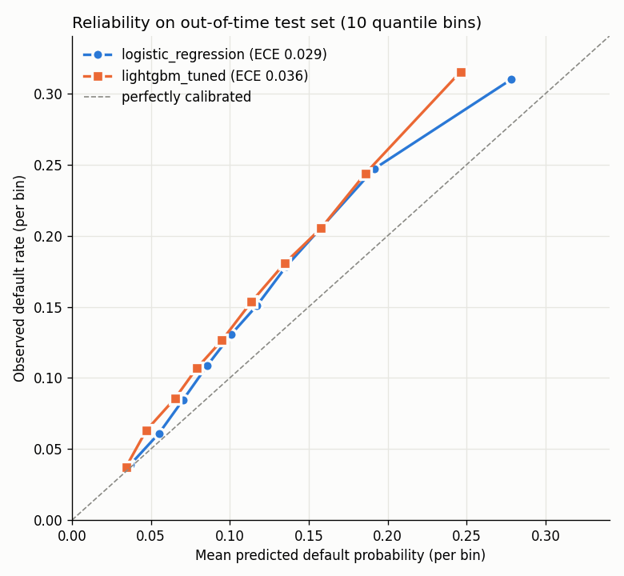

# Credit Risk Modeling — Report

All numbers in this report come from `reports/artifacts/metrics.json`, written by `make train` (`python -m src.train --save`). Derived numbers (expected cost) are computed from the confusion matrices stored there.

## 1. Problem

Predict, at application time, the probability that a 36-month Lending Club loan ends in default. Logistic regression is the benchmark, the way a scorecard would be built; LightGBM is the candidate main model. The question this phase answers is how much LightGBM beats LR out of time, with a confidence interval.

## 2. Data

Source: the Kaggle Lending Club download, `data/archive/accepted_2007_to_2018q4.csv/accepted_2007_to_2018Q4.csv` (git-ignored). The rejected-applications file has a different schema and is never read. Only the 15 columns the model maps are loaded (`LC_USECOLS` in `src/data.py`).

### 2.1 Target definition

`loan_status` is mapped for finished loans only (`TARGET_MAP` in `src/data.py`):

| `loan_status` | default |
|---|---:|
| Fully Paid | 0 |
| Does not meet the credit policy. Status:Fully Paid | 0 |
| Charged Off | 1 |
| Default | 1 |
| Does not meet the credit policy. Status:Charged Off | 1 |
| Current, Late (16-30 days), Late (31-120 days), In Grace Period | dropped |

Late loans are dropped rather than counted as defaults: they don't have a final outcome yet, and some of them cure.

### 2.2 Matured cohorts and loan term

The file is a snapshot taken around 2019-03-31 (`SNAPSHOT_DATE`). For a cohort issued in 2017, the loans that have *finished* by the snapshot are mostly early payoffs and fast charge-offs; the ones still running are dropped as `Current`. Keeping those cohorts would bias the default rate. A loan is therefore kept only if `issue_d + term ≤ SNAPSHOT_DATE`.

That filter keeps 36-month loans issued up to 2016-03 but 60-month loans only up to 2014-03. An out-of-time test set from 2015 onward would contain no 60-month loans, while training would mix them in, and 60-month loans default much more often than 36-month loans. The model is therefore restricted to 36-month loans (`TERM_MONTHS = 36`).

### 2.3 Row counts

| Step | Rows |
|---|---:|
| Rows read (blank footer lines removed) | 2,260,668 |
| Finished loans (status in `TARGET_MAP`) | 1,348,099 |
| FICO, DTI, income, amount and issue date present | 1,347,721 |
| Matured by 2019-03-31 | 779,013 |
| 36-month loans | 710,794 |

Final default rate: 14.22%.

### 2.4 Out-of-time split

| Split | Issue dates | Rows | Default rate | Used for |
|---|---|---:|---:|---|
| Train | 2007-06 – 2013-12 | 175,422 | 12.63% | fitting |
| Validation | 2014-01 – 2014-12 | 162,570 | 13.73% | early stopping, model selection, threshold |
| Test | 2015-01 – 2016-03 | 372,802 | 15.18% | final report only |

The test window is larger than the training window because Lending Club's volume grew quickly. The default rate rises across the three windows; section 5 shows the effect.

## 3. Features

Every feature must be known when the credit decision is made.

| Feature | Source | Why it's allowed |
|---|---|---|
| `fico` | mean of `fico_range_low` / `fico_range_high` | Bureau score pulled at application. (`last_fico_range_*` is post-origination and is not read.) |
| `dti` | `dti` | Debt-to-income from the application |
| `annual_income` | `annual_inc` | Stated on the application |
| `emp_length` | `emp_length` | Stated on the application; parsed to 0–10 years |
| `home_ownership` | `home_ownership` | Stated on the application |
| `open_acc` | `open_acc` | Bureau data at application |
| `revol_util` | `revol_util` | Bureau data at application |
| `loan_amount` | `loan_amnt` | Requested amount |
| `term` | `term` | Requested term (always 36 after the term filter, so it carries no signal here) |
| `purpose` | `purpose` | Stated on the application |
| `grade` | `grade` | Assigned by LC at origination (see below) |
| `int_rate` | `int_rate` | Set by LC from the grade at origination (see below) |
| `loan_to_income` | `loan_amount / annual_income` | Arithmetic on application fields |
| `installment_estimate` | amortization of amount, rate, term | Arithmetic on application fields |
| `installment_to_income` | installment / monthly income | Arithmetic on application fields |
| `emp_x_homeowner` | `emp_length` × owns or mortgages home | Arithmetic on application fields (previously misnamed `credit_age_proxy`) |

**LC grade and rate.** `grade` and `int_rate` are outputs of Lending Club's own risk model. They exist at decision time, so they're not leakage, but a model using them partly re-learns LC's score. `USE_LC_GRADE` in `src/features.py` (default `True`) controls them; setting it to `False` also drops the two installment features, because they're computed from `int_rate`. The results below use `True`.

**Leakage guard.** `tests/test_features.py` fails if any of `total_pymnt`, `total_rec_prncp`, `recoveries`, `collection_recovery_fee`, `last_pymnt_d`, `last_pymnt_amnt`, `last_fico_range_high`, `last_fico_range_low`, `out_prncp` is a model feature, or is in the list of columns read from the CSV.

**Preprocessing.** Median imputation, standard scaling (LR only) and one-hot encoding (unseen categories ignored) live inside each model's sklearn `Pipeline` and are fit on the training split only.

## 4. Models

**Logistic regression** (`src/models.py`): L2, `max_iter=2000`, no class reweighting. An earlier version used `class_weight="balanced"`, which inflates predicted probabilities and would make LR look badly calibrated for reasons unrelated to ranking. Class imbalance is handled by the cost-optimal threshold instead.

**LightGBM** (`src/train.py::tune_lightgbm_early_stopping`): 30 candidates sampled over `num_leaves`, `learning_rate`, `min_child_samples`, `feature_fraction` and `reg_lambda`. Each candidate is fit on train with up to 2,000 trees and early stopping (50 rounds) on validation PR-AUC, and the candidate with the best validation PR-AUC is kept.

Selected: `num_leaves=22`, `learning_rate=0.0374`, `min_child_samples=53`, `feature_fraction=1.0`, `reg_lambda=0.0014`, 85 trees (validation PR-AUC 0.2320). Early stopping at 85 trees with a moderate learning rate means the validation set stopped rewarding extra complexity quickly.

## 5. Results (out-of-time test set)

### 5.1 Discrimination and calibration

95% CIs are percentile intervals from 1,000 bootstrap resamples of the test set. The difference is computed on the same resamples for both models (paired).

| Model | ROC-AUC [95% CI] | Gini | KS | PR-AUC [95% CI] | Brier | ECE |
|---|---|---:|---:|---|---:|---:|
| Logistic regression | 0.6803 [0.6780, 0.6824] | 0.3606 | 0.2641 | 0.2593 [0.2565, 0.2621] | 0.1233 | 0.0287 |
| LightGBM | 0.6817 [0.6794, 0.6838] | 0.3633 | 0.2661 | 0.2612 [0.2585, 0.2643] | 0.1236 | 0.0359 |

| LightGBM − LR | Estimate | 95% CI |
|---|---:|---|
| ROC-AUC | +0.0014 | [+0.0006, +0.0021] |
| PR-AUC | +0.0019 | [+0.0011, +0.0028] |

**How much does LightGBM beat LR?** By about 0.14 ROC-AUC points and 0.19 PR-AUC points. With 372,802 test loans the CIs are tight enough that the gain is clearly not zero, but it's far too small to matter in practice. On Brier the two are tied (0.1233 vs 0.1236), and LightGBM's probabilities are slightly worse calibrated (ECE 0.0359 vs 0.0287). On these application-time features, most of the signal is linear, and much of it is already summarised in LC's own `grade` / `int_rate`.

PR-AUC should be read against the test default rate of 0.1518, which is what a random ranking would score.



Both curves sit above the diagonal: in every probability bin the observed default rate on 2015–16 loans is higher than predicted. That's consistent with the default rate rising from 12.6% (train) to 15.2% (test). Ranking holds up, but the probability *level* shifts over time, so the probabilities would need recalibrating on recent cohorts before being used directly (for pricing or expected loss).

### 5.2 Cost-aware threshold

Assumed costs: a missed default (FN) costs 5, a wrongly rejected good loan (FP) costs 1 (`CostMatrix`). Expected cost = 5·FN + 1·FP on the test set. The threshold that minimises expected cost is picked on the **validation** predictions and then applied to the test set unchanged.

| Model | Threshold | Flagged as default | Precision | Recall | FN | FP | Expected cost |
|---|---:|---:|---:|---:|---:|---:|---:|
| Logistic regression | 0.16 | 91,081 | 0.267 | 0.430 | 32,254 | 66,747 | 228,017 |
| LightGBM | 0.15 | 105,081 | 0.259 | 0.481 | 29,368 | 77,861 | 224,701 |

At the 0.5 threshold LR flags 480 loans and LightGBM flags none, so the expected cost there (282,274 and 282,940) is essentially the cost of having no model. Against that baseline the cost-optimal threshold cuts expected cost by 19.2% (LR) and 20.6% (LightGBM). The difference *between* the two models at their operating points is 3,316 cost units (1.5%), in line with the small AUC gap.

## 6. Known limitations

- **Binary target ignores timing.** A charge-off in month 3 and one in month 35 get the same label, and loan value depends heavily on when default happens. Survival / time-to-default modeling is the next phase.
- **Accepted loans only, no reject inference.** The model is trained and evaluated on applicants LC approved. Its performance on the full applicant population is unknown.
- **LC grade used as a feature.** `grade` and `int_rate` encode LC's own risk model, so part of the measured performance belongs to LC. A run with `USE_LC_GRADE = False` would show how much the borrower fields carry on their own; it isn't reported here.
- **36-month loans only.** 60-month loans are excluded because the matured out-of-time test set contains none.
- **Default rate shifts over time.** Test cohorts default more often than training cohorts, and both models under-predict on the test set.
- **The cost matrix is a heuristic.** 5:1 is a rule of thumb, not measured loss-given-default and margin.

## 7. Notebooks

`notebooks/01`–`05` explore the same data and the same Phase 1 run (EDA, modeling, SHAP and error analysis, calibration, drift). Their findings are written in each notebook's Takeaways cell; the figures they produce are in `reports/figures/`. They only read `reports/artifacts/`, so they cannot change the numbers in this report.

## 8. Reproduce

```bash
make install
make test     # 81 tests on synthetic fixtures
make train    # needs data/archive/; writes metrics.json and figures/reliability.png
make notebooks
```

`RANDOM_STATE = 42` fixes the search, the model seeds and the bootstrap.
